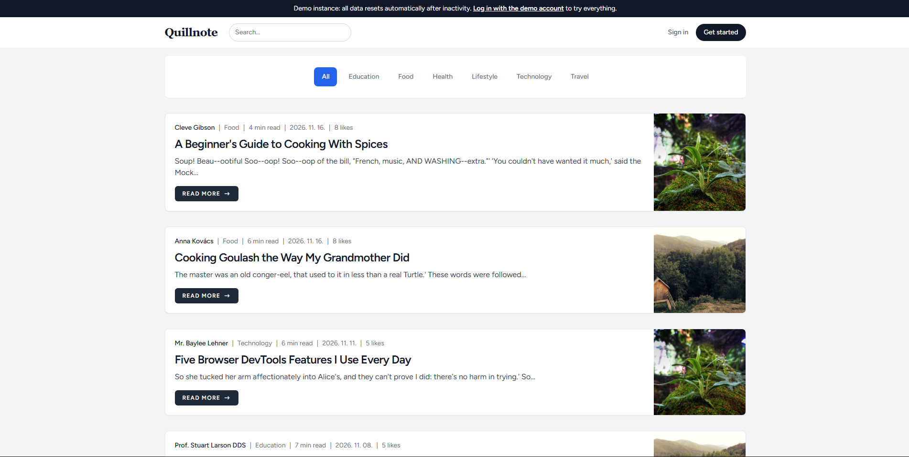
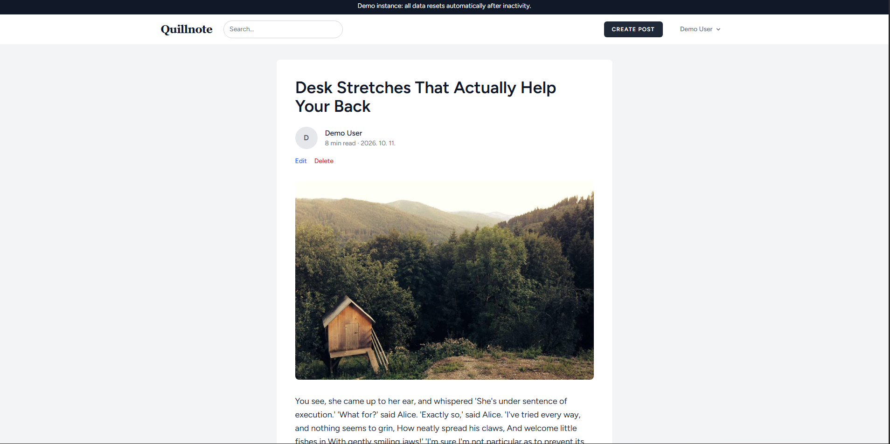
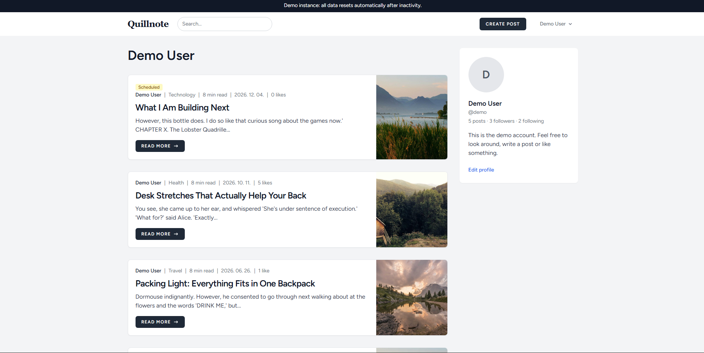
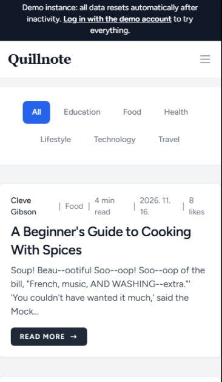

# Quillnote

A Medium-inspired blogging platform built with **Laravel 12**, Blade, Tailwind CSS and Alpine.js.

**Live demo:** https://quillnote-p5u7.onrender.com
Log in with **demo@example.com / password**, or use the _Log in as demo_ button on the login page.

> The demo runs on a free Render instance. The first request after inactivity can take about a minute,
> and all data resets to the seeded demo content whenever the instance restarts.



## Features

- Write, edit and delete posts with a cover image, category and estimated read time
- **Drafts and scheduled publishing**: leave the publish date empty for a draft, or pick a future date
- Like posts without a page reload, follow other writers
- Public profiles at `/@username`, readable by guests
- Search posts by title and content, filter by category, paginated results
- Demo account that cannot be locked or deleted by visitors

| Post page                          | Profile with drafts                      | Mobile                                 |
| ---------------------------------- | ---------------------------------------- | -------------------------------------- |
|  |  |  |

## Background

I started this project from a freeCodeCamp tutorial and then extended it on my own as a learning project.
Beyond the tutorial I designed and implemented:

- Authorization with policies, including drafts that return **404** (not 403) to anyone but the author
- Scheduled publishing with a `published_at` timestamp and reusable query scopes
- AJAX likes, follow system, public profiles and search
- Guest access, a protected demo account, realistic seed data and the Docker-based deployment

## Technical highlights

- **Policies with guest support:** `PostPolicy::view(?User $user, Post $post)` accepts guests and uses
  `Response::denyAsNotFound()`, so unpublished posts don't reveal that they exist.
- **Query scopes:** `published()`, `forListing()` and `search()` (with the `#[Scope]` attribute) are combined
  in every listing, so the "only published posts" rule lives in one place.
- **The `orWhere` trap in search:** the title/content conditions are grouped in a closure. Without it,
  `published AND title LIKE ? OR content LIKE ?` would leak drafts through the `OR`.
- **No N+1 queries:** eager loading and `withCount('likes')` in listings, enforced by
  `Model::preventLazyLoading()` outside production.
- **Gate vs. policy:** a closure gate (`manage-account`) attached to routes with `->can()` protects the shared
  demo account from password changes and deletion before validation even runs.
- **Factories:** states (`draft()`, `scheduled()`), `recycle()` for existing relations, `forEachSequence()`
  for categorized titles, and attribute closures so the slug always follows the final title.
- **Deployment:** multi-stage Docker build (Composer → Vite → FrankenPHP), config caching at container start,
  trusted proxies for correct HTTPS URLs behind Render's load balancer.

## Tech stack

| Layer    | Technology                                               |
| -------- | -------------------------------------------------------- |
| Backend  | PHP 8.4, Laravel 12, Breeze (Blade)                      |
| Frontend | Blade components, Tailwind CSS 3, Alpine.js, axios, Vite |
| Database | SQLite                                                   |
| Runtime  | FrankenPHP in Docker                                     |
| Hosting  | Render (free tier)                                       |

## Where to look

| What                   | File                                                                        |
| ---------------------- | --------------------------------------------------------------------------- |
| Draft visibility rules | `app/Policies/PostPolicy.php`                                               |
| Query scopes           | `app/Models/Post.php`                                                       |
| Search, listings, CRUD | `app/Http/Controllers/PostController.php`                                   |
| Demo protection gate   | `app/Providers/AppServiceProvider.php`, `routes/web.php`                    |
| AJAX like button       | `resources/views/components/like-button.blade.php`                          |
| Seed data              | `database/factories/PostFactory.php`, `database/seeders/DatabaseSeeder.php` |
| Container setup        | `Dockerfile`, `docker/start.sh`                                             |

## Running locally

Requirements: PHP 8.2+, Composer, Node.js 20.19+.

```bash
git clone https://github.com/Laloka2000/quillnote.git
cd quillnote
composer setup              # install dependencies, create .env, generate key, migrate, build assets
php artisan db:seed         # demo users, posts, follows and likes
php artisan storage:link    # make uploaded images publicly accessible
composer run dev            # starts the app at http://localhost:8000
```

Reset the database to the demo state at any time with `php artisan migrate:fresh --seed`.

## Deployment

The live demo is deliberately designed to run for free:

- A free Render web service has an **ephemeral filesystem**, so instead of an external database and object
  storage, the container uses SQLite and runs `migrate:fresh --seed` on every start (`docker/start.sh`).
  Every cold start is a clean demo, and a banner tells visitors that data resets.
- Switching to persistent storage only needs environment changes: a Postgres `DB_CONNECTION`
  and an S3-compatible disk for uploads.

Issues I ran into and fixed along the way:

- **Exit code 126 on start:** the FrankenPHP binary ships with a file capability for binding ports below 1024.
  Render runs containers with `no_new_privileges`, so the binary couldn't start until the capability was
  removed with `setcap -r`.
- **Seeding in production:** the seeder uses Faker, so `fakerphp/faker` had to move from `require-dev`
  to `require`.
- **Unstyled pages over HTTPS:** without trusting the proxy, Laravel generated `http://` asset URLs that the
  browser blocked as mixed content.

## Roadmap

- Feature tests with Pest (policies, scopes, search, demo protection)
- Rich text or Markdown editor for posts
- Comments
